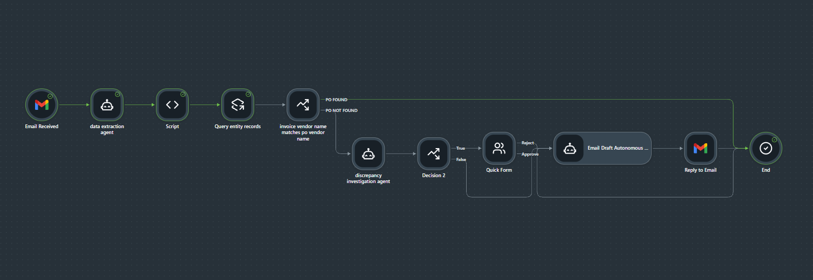
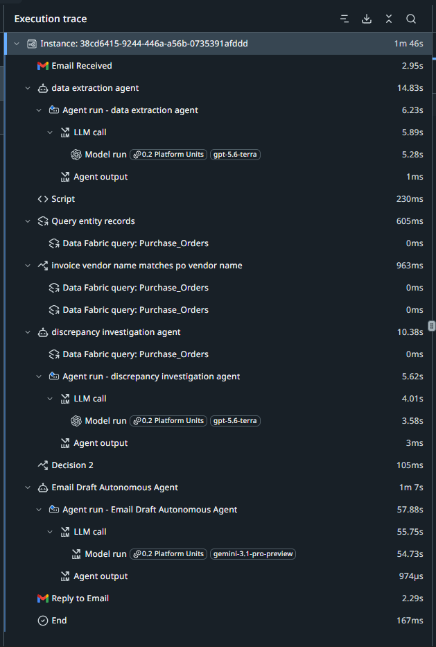

# Invoice-to-PO Automation with AI Agents (UiPath Maestro)

An email-triggered automation that reads vendor invoices, matches them to purchase orders, investigates discrepancies with AI agents, and routes large discrepancies to a human for approval before replying to the sender.

Built with **UiPath Maestro, Agents, Data Fabric and Integration Service (Gmail)**.

> All purchase orders, contracts and invoices in this repository are **sample data created for demonstration**. Company names are used only as fictional examples.

---

## What it does

1. Watches a Gmail inbox for new emails whose subject contains **"Invoice"**.
2. An AI **Data Extraction agent** converts the invoice text into structured JSON (invoice number, dates, PO reference, vendor, line items, subtotal, tax, total).
3. A **JavaScript step** reshapes that JSON for the rest of the flow.
4. The flow looks up the matching purchase order in **Data Fabric** (`Purchase_Orders` entity) using the PO number.
5. A **Discrepancy Investigation agent** compares the invoice with the PO line by line (quantities, unit prices, tax, freight, vendor name). When prices disagree, it searches signed vendor contracts through a RAG tool to find evidence. It returns:
   - a list of discrepancies, each with severity (`minor`, `major`, `critical`) and evidence
   - the total amount difference
   - a recommendation: `approve`, `escalate` or `reject`
6. If the total difference is **more than $100** (or a serious issue is found), the case is **escalated** to a human reviewer through a **Quick Form** (Approve / Reject).
7. An **Email Draft agent** writes a professional HTML reply, and the flow **replies to the original email**.

## Flow diagram



| Step | Node | Type | Purpose |
|------|------|------|---------|
| 1 | Email Received | Gmail trigger | Starts the flow on new invoice emails |
| 2 | Data Extraction agent | AI agent | Invoice text to structured JSON |
| 3 | Script | JavaScript | Cleans and reshapes the extracted data |
| 4 | Query entity records | Data Fabric | Finds the PO that matches the invoice |
| 5 | PO check | Decision | Ends the flow if no PO is found, otherwise continues |
| 6 | Discrepancy Investigation agent | AI agent + RAG | Compares invoice vs PO, checks contracts, recommends an action |
| 7 | Decision 2 | Decision | Was the case escalated? |
| 8 | Quick Form | Human approval | Reviewer approves or rejects large discrepancies |
| 9 | Email Draft agent | AI agent | Writes the reply email in HTML |
| 10 | Reply to Email | Gmail action | Sends the reply on the original thread |
| 11 | End | End | Flow complete |

### Sample execution

A successful run, with timing for every step:



## Repository structure

```
invoice-po-automation/
├── README.md
├── screenshots/
│   ├── flow-canvas.png
│   └── execution-trace.png
├── solution/
│   └── Automatrix.uis              # UiPath solution package (flow + agents)
├── data/
│   ├── Purchase_Orders_export.csv  # 7 sample purchase orders
│   └── data-fabric-schema.json     # Purchase_Orders and Vendor_Alias entities
├── contracts/                      # Sample vendor contracts used by the RAG tool
│   ├── google-cloud-services-agreement.pdf
│   ├── apex-manufacturing-supply-agreement.pdf
│   └── stratton-office-supply-reseller-agreement.pdf
├── test-inputs/
│   └── Input_Mails.docx            # Sample invoice emails for testing
└── docs/
    └── Project_Building_Guide.docx # Full build guide with prompts and schemas
```

## Data model

**`Purchase_Orders`** (Data Fabric entity): `poNumber`, `poDate`, `vendorName`, `lineItems`, `subtotal`, `taxAmount`, `freightAmount`, `totalAmount`

**`Vendor_Alias`** (Data Fabric entity): `vendorName`, `vendorAlias`. This maps the vendor name on a PO to alternative names that may appear on invoices. It is defined in the schema and is empty in the sample data.

## Agents

| Agent | Input | Output |
|-------|-------|--------|
| Data Extraction | `InvoiceText` (string) | `invoiceData` (JSON string) |
| Discrepancy Investigation | `invoiceData`, `poData` (JSON strings) | `discrepancies[]`, `totalAmountDelta`, `recommendation`, `escalated` |
| Email Draft | Output of the Discrepancy agent | HTML email body |

The full system prompts, user prompts and input/output schemas are in [`docs/Project_Building_Guide.docx`](docs/Project_Building_Guide.docx).

### Key business rules

- A total difference **over $100** always escalates to a human.
- An invoice line with no matching PO line is automatically **critical**.
- Contract evidence must actually be retrieved before a price difference can be called "explained".
- When contract and catalog disagree, the **contract wins**.
- `reject` is reserved for clear evidence of fraud. When unsure, the agent escalates.

## Test scenarios

The sample data was designed to exercise different paths:

| Scenario | Source | What it tests |
|----------|--------|---------------|
| Clean invoice | Mail 1 in `Input_Mails.docx` (Apex Manufacturing, PO-2026-12035) | Invoice matches the PO and the contract prices |
| Vendor name mismatch | Mail 2 in `Input_Mails.docx` (vendor shown as "UiParth") | Invoice issued under a different name than the PO and contract |
| Freight differences | Stratton POs in the CSV | Contract says standard ground freight is included, so extra freight needs justification |
| Price and entity checks | Contracts folder | Negotiated unit prices, authorized invoicing entities, escalation clauses |

## Setup

**You need:** a UiPath Automation Cloud account with Maestro, Agents, Data Fabric, Integration Service and Action Center (for the Quick Form), plus a Gmail account to connect.

1. **Create the Data Fabric entities.** In Data Fabric, go to Import/Export, choose Import and upload `data/data-fabric-schema.json`.
2. **Load the sample POs.** Open the `Purchase_Orders` entity, go to the Data tab and import `data/Purchase_Orders_export.csv`.
3. **Index the contracts.** Create a context-grounding index named `vendor_index` from the PDFs in `contracts/`, so the Discrepancy agent can search them.
4. **Import the solution.** Import `solution/Automatrix.uis` into Studio Web.
5. **Reconnect Gmail.** Re-authenticate the Gmail connection with your own account.
6. **Set the reviewer.** Assign the Quick Form to your own user.
7. **Publish and test.** Publish the flow, then email yourself an invoice from `test-inputs/Input_Mails.docx` with a subject containing **Invoice**.

Exact menu names in UiPath may differ slightly between versions. See `docs/Project_Building_Guide.docx` for the detailed walkthrough.

## Tech stack

UiPath Maestro · UiPath Agents (LLM-based) · UiPath Data Fabric · Integration Service (Gmail) · Action Center (human-in-the-loop) · JavaScript · RAG over vendor contracts

## Possible improvements

- Notify the sender when no matching PO is found instead of ending silently.
- Use the `Vendor_Alias` entity to recognize known alternate vendor names automatically.
- Show every discrepancy in the approval form, not only the first one.
- Add support for invoices arriving as PDF attachments.

## Author

Adrija Mandal · [GitHub](https://github.com/codadrija) · [LinkedIn](https://www.linkedin.com/in/adrija-mandal-37202a326)